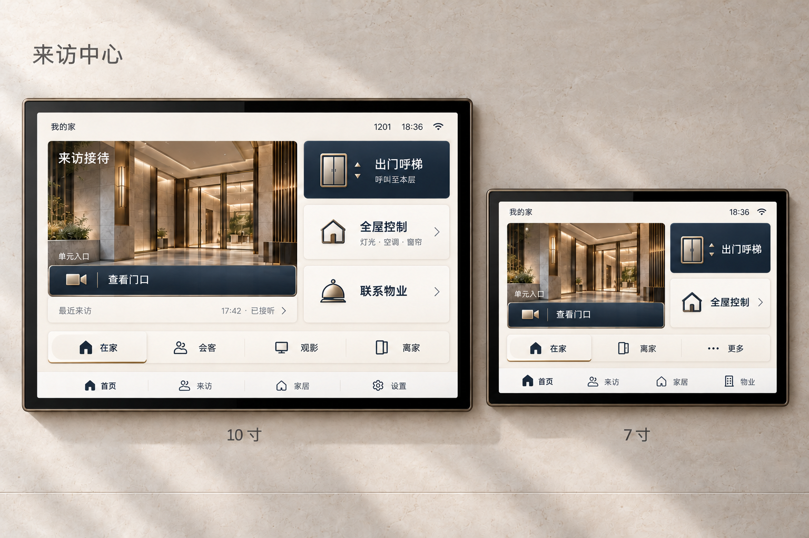

# 楼宇室内机 UI 需求说明

**版本：V0.1｜方案阶段｜更新日期：2026-10-31**

本文描述住户界面的产品目标，当前交付物是 PC 开发网页。运行方式见[首页](../README.md)。

## 1. 产品定位与已确认方向

产品定位为**高端、现代的楼宇室内机**，整合楼宇通行、门口视频对讲与智能家居控制。项目只替换住户家中的室内机，不改造物业侧服务器或楼栋设备。

已确认的核心要求：

- 同时覆盖 **7 寸和 10 寸**，分别适配信息密度、布局与操作区域。
- 以 **C「来访中心」方案**作为主要设计方向。
- 以选中的预览图作为整体布局和视觉气质参考：门厅主视觉、右侧快捷操作、下方场景与底部导航。
- 核心功能包括门禁、门口呼叫、视频对话、电梯控制和智能家居。
- 整体应具有高端感和辨识度，按钮需要进一步精致化，减少常见模板感。

当前方案状态：

- **横屏**为当前设计基准，最终屏幕比例、分辨率和硬件尺寸待确认。
- 最新的按钮材质、图标及边缘处理属于**视觉深化方向**，尚未作为最终冻结规范。
- 预览图中的房号、时间、来访记录和门厅照片均为示例内容，正式版本需要替换为项目实际内容。

### 1.1 预览图与使用边界

参考文件：[双屏建筑感门厅控制界面.png](双屏建筑感门厅控制界面.png)。

- 10 寸图用于参考完整接待区、三项快捷操作及四个常用场景；7 寸图用于参考精简接待区、两项高频操作和“更多”场景入口。
- 设备边框、图片比例、材质和图标细节仅作视觉参考，不能据此冻结硬件参数或精确组件尺寸。
- 图中 10 寸底部为“首页、来访、家居、设置”，7 寸为“首页、来访、家居、物业”。这是待统一的导航差异，不是最终双尺寸导航规范；正式设计遵循第 3 节。
- 文本需求与示意细节有差异时，以本文明确要求为依据；未确认内容仍保持待确认。

## 2. 功能与页面范围

| 模块 | 页面内容与操作要求 | 范围说明 |
| --- | --- | --- |
| 首页 | 入口主视觉、查看门口、出门呼梯、全屋控制、常用场景、状态提示 | 首期核心页面 |
| 门口查看 | 入口名称、对应视频画面、开始对讲、打开对应门 | 根据实际接入的园区门、单元门等显示 |
| 来电与视频通话 | 呼叫来源、视频、接听、拒接、麦克风、音量、结束通话、开门 | 首期核心功能；具体对讲对象待确认 |
| 电梯控制 | 呼梯到本层、请求状态；按系统能力提供目的地选择 | 目的地、轿厢信息及实时状态依赖电梯接口 |
| 智能家居 | 按房间查看设备，控制灯光、空调、窗帘，执行常用场景 | 首批设备及具体控制能力待确认 |
| 来访记录 | 已接、未接、入口名称、时间 | 抓拍、留言等能力另行确认 |
| 物业服务 | 联系物业或管理中心 | 界面预留，按项目实际能力启用 |
| 设置 | 音量、铃声、亮度、连接状态等 | 勿扰、夜间显示、屏幕清洁等功能待确认 |

页面是否可操作由实际能力、设备状态和权限决定。未接入能力应明确说明暂不可用；原型演示内容须与真实设备状态区分，不得以占位数据表示已接入或执行成功。

## 3. 首页布局与尺寸适配

首页采用“**入口接待为主、楼宇通行为高频操作、智能家居为常用辅助控制**”的信息层级。

| 区域 | 10 寸版本 | 7 寸版本 |
| --- | --- | --- |
| 顶部状态栏 | 我的家、房号、时间、连接状态 | 压缩辅助信息，保留必要状态 |
| 左侧主区域 | 门厅封面、入口名称、查看门口、最近来访摘要 | 保留门厅封面、入口名称与查看门口，精简记录摘要 |
| 右侧操作区 | 出门呼梯、全屋控制、联系物业 | 优先保留出门呼梯、全屋控制，收纳低频入口 |
| 场景栏 | 在家、会客、观影、离家 | 在家、离家、更多 |
| 底部导航 | 首页、来访、家居及系统入口 | 与大屏保持一致的操作逻辑，统一安排物业和设置入口 |

适配要求：

- 两个尺寸分别设计栅格、间距和内容密度，不将 10 寸版本简单等比缩小。
- 7 寸优先保证核心按钮、中文标签和操作区域清晰可用。
- 左右区域比例依据实际屏幕调整，预览图比例作为参考。
- 同一功能在两个尺寸上保持一致的名称、图标和操作结果。
- 默认首页使用**静态门厅封面**；用户点击查看或收到呼叫后，进入实际视频画面。
- 物业与设置的最终导航位置，在详细设计阶段统一确定。

## 4. 视觉设计要求

### 4.1 整体风格

关键词：**高端、现代、克制、精密、具有建筑感和产品辨识度。**

当前配色方向：

- 暖白、浅石材灰作为主要背景与次级表面。
- 深墨蓝作为主要操作的强调色。
- 香槟色或暖金属色仅用于少量边缘、图标和选中态细节。
- 文字与操作状态保持清楚的明暗对比。

材质表现采用轻量的表面明暗、浅层边缘和细微高光，形成与门厅照片、设备边框协调的整体气质。

### 4.2 按钮与图标

按钮需要形成统一的设计体系，并体现不同操作角色：

| 类型 | 示例 | 设计要求 |
| --- | --- | --- |
| 执行动作 | 出门呼梯、开门 | 主次明确，提供按下、等待及执行结果反馈 |
| 页面入口 | 全屋控制、联系物业 | 入口关系清楚，可使用轻量的方向提示 |
| 场景操作 | 在家、会客、观影、离家 | 清晰表达选中状态和执行状态 |

当前视觉深化方向：

- **出门呼梯：**使用具有门框、双门和中缝特征的电梯图标，配合深色主按钮。
- **全屋控制：**图标融入房屋、门洞或空间结构特征，与电梯图标保持一致的几何语言。
- **联系物业：**探索服务铃等服务意象，保留明确中文名称。
- **查看门口：**采用贴合门厅照片底边的操作条，与入口主区域形成整体。
- **场景栏：**采用连续分段关系，以表面变化和细短标记突出当前状态。

图标应统一线宽、转角、光学尺寸和材质表现。核心操作保留中文标签，保证小屏上的识别性。以上细节在最终视觉评审后冻结。

## 5. 核心交互要求

### 5.1 门口查看与视频对话

- 视频画面必须明确标注来源，例如“园区大门”“1 栋单元门”。
- 仅查看视频时，麦克风默认关闭；开始对讲后，清楚显示音频接通状态。
- 来电时进入明确的接听界面，突出呼叫来源、视频和接听／拒接操作。
- 接通后提供麦克风、音量、结束通话和开门操作。
- 开门按钮直接显示控制对象，例如“开单元门”。
- 开门需要明确确认，具体确认方式在交互设计阶段确定。
- “开门指令已发送”“设备已确认”“门已打开”应准确区分；“门已打开”仅在获得真实门状态反馈后显示。

### 5.2 电梯控制

- 区分“住户出门呼梯”和“授权访客乘梯”两个任务。
- 首页主操作为“出门呼梯”，目标是将电梯呼叫至住户所在楼层。
- 大厅、车库等目的地选择，按实际接口与权限提供。
- 根据真实反馈展示请求已发送、已受理、已分配、已到达、失败或暂不可用等状态。
- 轿厢编号、实时楼层、预计等待时间等信息，仅在系统提供可靠数据时展示。
- 访客楼层授权作为独立操作，是否纳入首期由项目确认。
- 传输 ACK 只证明报文收到，不等于业务已受理、已分配或物理到梯；只有传输证据时保留实际结果未确认状态。

### 5.3 智能家居与场景

- 家居页按房间组织设备，首页提供常用设备或场景入口。
- 灯光、空调、窗帘的控制形式与设备实际能力匹配。
- 场景名称清楚，执行内容应可查看或配置。
- 离家场景与呼梯、开门、访客授权等联动，需要明确配置，不默认绑定。
- 场景执行时应区分执行中、全部完成、部分失败和执行失败。

### 5.4 通用状态反馈

设计应覆盖：

- 默认、按下、选中、不可用。
- 加载中、等待确认、执行成功、执行失败。
- 视频连接中、视频不可用、通话结束、未接来电。
- 设备离线、连接异常、请求超时。
- 无来访记录、未接入设备等空状态。

执行结果以实际回执为依据。颜色应结合文字、图标或形态共同表达状态。请求已发送、传输确认、业务确认与物理执行结果应分别表达，不能用计时动画或乐观更新替代真实反馈。

## 6. 可读性与操作要求

- 核心动作保持稳定位置，优先满足站立操作和快速识别。
- 中文名称简洁，图标与文字之间留有清楚间距。
- 7 寸版本重点检查文字大小、按钮间距、手指遮挡与误触问题。
- 材质、阴影和装饰线不能削弱操作区域与文字的识别。
- 具体字号、圆角、间距和触控尺寸，在获得分辨率及屏幕参数后制定。
- 来电优先级、通话期间其他控制的使用方式、第二路呼叫处理，需要在交互稿中明确。

## 7. 设计交付与验收要求

建议设计交付包括：

- 7 寸、10 寸首页及核心二级页面。
- 来电、通话、开门、呼梯、家居控制等关键流程。
- 按钮、导航、场景栏及状态组件。
- 图标资源与颜色、字体、间距、圆角规范。
- 加载、失败、离线、空内容等异常状态页面。
- 必要的交互标注与可编辑设计源文件。

验收重点：

- 来访接待、出门呼梯、家居控制的主次清楚。
- 两种尺寸均能清楚阅读和完成核心操作。
- 图标、按钮、状态反馈形成统一体系。
- 页面展示与实际接入能力一致。
- 操作反馈准确，能区分请求发送与实际执行结果。

设计评审、离线原型验证和实机业务验收分别记录。预览图不代表实机验证通过；没有硬件参数时注明布局假设，未接入接口的流程不能标记为业务验收完成。

## 8. 待确认事项

以下事项尚未冻结，应在获得硬件参数、接口证据或评审结论后更新；不能从预览图或原型行为推定为已确认。

1. 7 寸和 10 寸的分辨率、屏幕比例、横竖屏及硬件外形。
2. 实际接入的门禁入口数量、名称和控制权限。
3. 视频对讲对象，以及物业呼叫、住户互通等能力范围。
4. 电梯接口支持的呼梯、目的地、回执与访客授权能力。
5. 首批智能家居设备、控制协议和场景动作。
6. 来访记录、抓拍、留言及物业服务的首期范围。
7. 开门确认、来电打断、第二路呼叫的交互规则。
8. 最新按钮方案是否通过，以及最终颜色、字体、图标和状态规范。
9. 物业与设置在 7 寸、10 寸版本中的统一导航位置。
